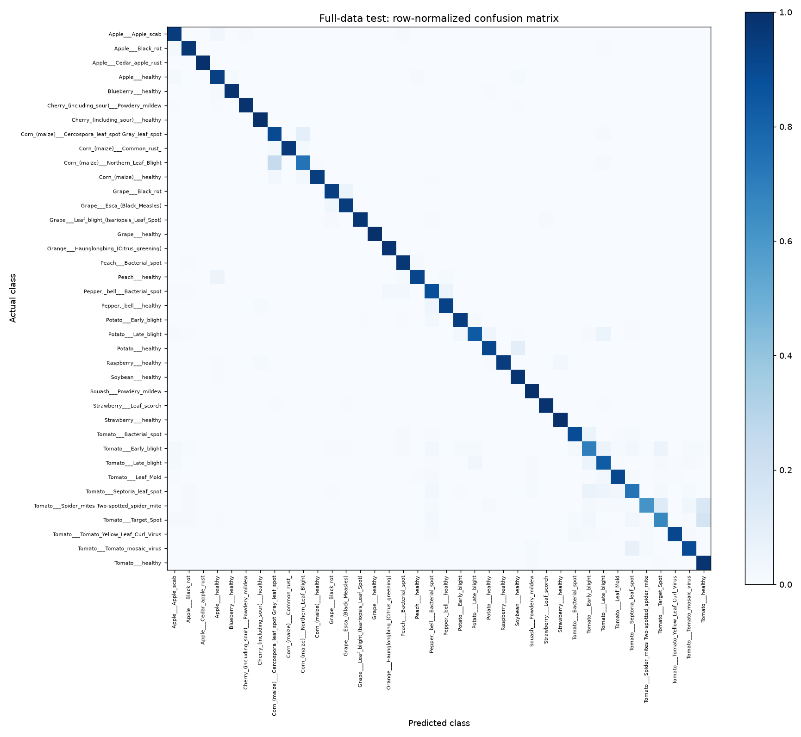
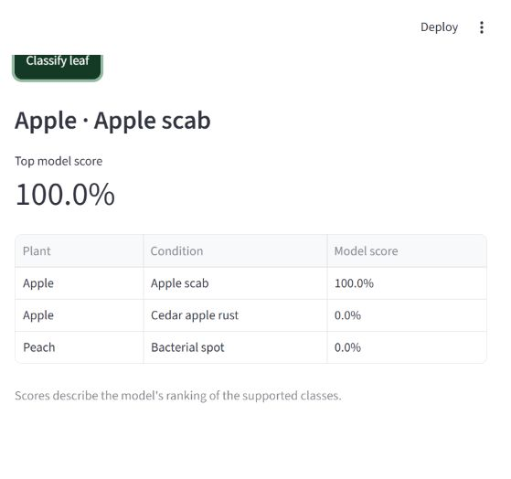

# Plant disease classifier: final evaluation

Completed and verified on 2026-10-12T08:08:30.164384+00:00. This is a local educational classifier for 38 supported crop-condition classes across 14 crops.

## Data and isolation

The audit decoded 54,305 PlantVillage color images. The usable splits contain 36,124 training, 6,494 validation and 10,709 test images. 978 images were quarantined to preserve source test groups.

There is no resolved-group or identical-pixel overlap between usable splits. Physical-leaf metadata resolves 40,490 images; 13,815 require filename fallback. That fallback cannot identify otherwise unlinked photographs of the same physical leaf.

## Training and model selection

The CNN trained for 1 epoch(s) on all eligible training images. The ImageNet-pretrained ResNet18 trained its new 38-class classifier for 1 epoch(s), then fine-tuned its final residual stage for 1 epoch(s). Model selection and the uncertainty rule used validation data only.

| Candidate | Best validation accuracy | Best validation macro F1 |
|---|---:|---:|
| Small CNN | 58.68% | 0.5208 |
| ResNet18 | 90.95% | 0.8844 |

Selected model: **resnet18**, version `full_data-resnet18-epoch-2`, trained on 36,124 images.

[CNN training history](artifacts/runs/full-cpu-20261012-051407-small-cnn/history.json) · [CNN learning curves](artifacts/runs/full-cpu-20261012-051407-small-cnn/learning_curves.png) · [ResNet18 training history](artifacts/runs/full-cpu-20261012-051407-resnet18/history.json) · [ResNet18 learning curves](artifacts/runs/full-cpu-20261012-051407-resnet18/learning_curves.png)

## Complete held-out test results

- Images: **10,709**, all 38 classes; the test split was not sampled.
- Accuracy: **91.33%**.
- Macro F1: **0.8931**.
- Batch evaluation time: 535.8 seconds; 50.0 ms per image including test loading and transforms.
- Warm single-image preprocessing and inference: median 45.6 ms on this CPU over five runs. This excludes uploading, decoding and initial model loading.

[Full metrics](reports/full-cpu-20261012-051407-test/metrics.json) · [Every test prediction](reports/full-cpu-20261012-051407-test/predictions.csv) · [Confusion matrix CSV](reports/full-cpu-20261012-051407-test/confusion_matrix.csv)

## Per-class results

| Class | Precision | Recall | F1 | Test images |
|---|---:|---:|---:|---:|
| Apple___Apple_scab | 0.7908 | 0.9528 | 0.8643 | 127 |
| Apple___Black_rot | 0.8765 | 0.9726 | 0.9221 | 146 |
| Apple___Cedar_apple_rust | 0.9630 | 1.0000 | 0.9811 | 52 |
| Apple___healthy | 0.9085 | 0.9371 | 0.9225 | 286 |
| Blueberry___healthy | 0.9845 | 0.9815 | 0.9830 | 324 |
| Cherry_(including_sour)___Powdery_mildew | 0.9954 | 0.9863 | 0.9908 | 219 |
| Cherry_(including_sour)___healthy | 0.8978 | 1.0000 | 0.9462 | 123 |
| Corn_(maize)___Cercospora_leaf_spot Gray_leaf_spot | 0.5926 | 0.8972 | 0.7138 | 107 |
| Corn_(maize)___Common_rust_ | 0.9952 | 0.9631 | 0.9789 | 217 |
| Corn_(maize)___Northern_Leaf_Blight | 0.8907 | 0.7409 | 0.8089 | 220 |
| Corn_(maize)___healthy | 0.9958 | 0.9480 | 0.9713 | 250 |
| Grape___Black_rot | 0.9080 | 0.9405 | 0.9240 | 168 |
| Grape___Esca_(Black_Measles) | 0.9507 | 0.9507 | 0.9507 | 284 |
| Grape___Leaf_blight_(Isariopsis_Leaf_Spot) | 0.9900 | 0.9755 | 0.9827 | 204 |
| Grape___healthy | 1.0000 | 1.0000 | 1.0000 | 100 |
| Orange___Haunglongbing_(Citrus_greening) | 0.9897 | 0.9806 | 0.9851 | 980 |
| Peach___Bacterial_spot | 0.9688 | 0.9723 | 0.9705 | 542 |
| Peach___healthy | 0.8333 | 0.9155 | 0.8725 | 71 |
| Pepper,_bell___Bacterial_spot | 0.6822 | 0.8795 | 0.7684 | 166 |
| Pepper,_bell___healthy | 0.9359 | 0.9293 | 0.9326 | 283 |
| Potato___Early_blight | 0.9337 | 0.9451 | 0.9394 | 164 |
| Potato___Late_blight | 0.9124 | 0.8349 | 0.8719 | 212 |
| Potato___healthy | 0.6444 | 0.9062 | 0.7532 | 32 |
| Raspberry___healthy | 1.0000 | 0.9506 | 0.9747 | 162 |
| Soybean___healthy | 0.9856 | 0.9836 | 0.9846 | 973 |
| Squash___Powdery_mildew | 0.9617 | 0.9974 | 0.9792 | 378 |
| Strawberry___Leaf_scorch | 0.9752 | 0.9850 | 0.9801 | 200 |
| Strawberry___healthy | 0.9412 | 1.0000 | 0.9697 | 80 |
| Tomato___Bacterial_spot | 0.9129 | 0.8899 | 0.9013 | 436 |
| Tomato___Early_blight | 0.6008 | 0.6930 | 0.6436 | 215 |
| Tomato___Late_blight | 0.8298 | 0.8320 | 0.8309 | 375 |
| Tomato___Leaf_Mold | 0.8619 | 0.9070 | 0.8839 | 172 |
| Tomato___Septoria_leaf_spot | 0.8646 | 0.7389 | 0.7968 | 337 |
| Tomato___Spider_mites Two-spotted_spider_mite | 0.9112 | 0.6094 | 0.7303 | 320 |
| Tomato___Target_Spot | 0.7346 | 0.6632 | 0.6971 | 288 |
| Tomato___Tomato_Yellow_Leaf_Curl_Virus | 0.9970 | 0.9082 | 0.9505 | 1100 |
| Tomato___Tomato_mosaic_virus | 0.6146 | 0.8939 | 0.7284 | 66 |
| Tomato___healthy | 0.7529 | 0.9788 | 0.8511 | 330 |

The full-data run resumed from the completed classifier checkpoint after an interruption. The unfinished fine-tuning epoch was restarted. Optimizer and random state were not restored for an exact batch-level continuation.

## Uncertainty and scope

The score threshold is 0.138659. On validation data it accepts 6,494/6,494 images (100.00% coverage), with 90.95% accuracy among accepted examples. This estimate is not probability calibration or a detector for unsupported inputs.

**Independent field-photo performance has not been measured.** PlantVillage results do not establish performance under field backgrounds, lighting or unsupported diseases. A verified independent-photo set can be evaluated separately with the command in the README.

## Final verification

All 14 regression checks passed, with no skipped tests. They cover split isolation, class coverage, upload size/type/pixel limits, RGB conversion, packaged label and preprocessing contracts, consistent saved-model reload predictions, resumable stage boundaries, and the app's classification and unreadable-upload paths. The app prediction was checked against the shared prediction module. Dependency consistency also passed.

App tests inject JPEG bytes into the uploader using Streamlit AppTest and click the real classification button. They exercise the application script; they do not simulate a browser's native file-selection dialog.

[Verification record](reports/project_verification.json) · [Model card](artifacts/model_bundle/model_card.json) · [Data audit](reports/data_audit.json)

## Browser preview

The final model was tested through the local browser upload and classification flow using a public PlantVillage Apple scab photograph. The page displayed Apple scab and three ranked alternatives. The displayed score is a model score for this example.

[Browser verification record](reports/browser_verification.json)
