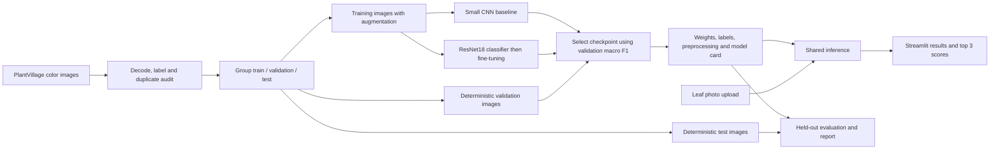

# Plant disease classifier

An educational deep learning project that classifies one leaf photograph into a supported crop-condition category and displays predictions in a Streamlit application.

Current progress: **Complete. The final resnet18 model scored 91.33% accuracy and 0.8931 macro F1 on all 10,709 held-out images. All 14 regression checks passed. See [the final evaluation](EVALUATION.md). Field-photo accuracy remains unmeasured.**

Read [the project scope](PROJECT_SCOPE.md) for inputs, outputs, class coverage, architecture decisions, and completion criteria. The canonical class list is in [supported_classes.json](configs/supported_classes.json).

## Use the packaged app

The repository includes the trained ResNet18 model and an example leaf photo. Running the app and its regression tests does not require downloading the training dataset. Install Python 3.12 and Git, then clone the project:

```bash
git clone https://github.com/deepanshunig/plant-disease-classifier.git
cd plant-disease-classifier
```

On Windows, open PowerShell in the project folder:

```powershell
.\setup.ps1 -PythonExecutable python
.\start_app.ps1
```

On Linux, create a virtual environment and install the CPU dependencies:

```bash
python3.12 -m venv .venv
source .venv/bin/activate
python -m pip install --upgrade pip
python -m pip install torch==2.9.1 torchvision==0.24.1 --index-url https://download.pytorch.org/whl/cpu
python -m pip install -r requirements.txt
python -m streamlit run app.py
```

On macOS, use the PyPI wheels as recommended by the [official PyTorch installation instructions](https://pytorch.org/get-started/previous-versions/#v291):

```bash
python3.12 -m venv .venv
source .venv/bin/activate
python -m pip install --upgrade pip
python -m pip install torch==2.9.1 torchvision==0.24.1
python -m pip install -r requirements.txt
python -m streamlit run app.py
```

Open [the local app](http://127.0.0.1:8510), select a JPEG or PNG leaf photo, and click **Classify leaf**. You can try `examples/apple_scab.jpg`. Publishing this repository on GitHub shares the project; it does not host the Streamlit app.

## Data flow



## Build sequence

1. **Complete:** Define scope and supported classes.
2. **Complete:** Set up Python, a virtual environment, dependencies, and an image-to-model check.
3. **Complete:** Download and inspect PlantVillage color images.
4. **Complete:** Create and verify leaf-group train/validation/test splits.
5. **Complete:** Build preprocessing and data loaders; verify a real leaf image and training batches.
6. **Complete:** Train and document the full-data CNN baseline.
7. **Complete:** Build the ResNet18 transfer-learning model.
8. **Complete:** Train ResNet18 on the full training split and select its best validation checkpoint.
9. **Complete:** Evaluate all 10,709 held-out images with per-class metrics and a confusion matrix. Independent-photo evaluation remains unmeasured.
10. **Complete:** Package shared inference and build the Streamlit interface.
11. **Complete:** Verify model reload, upload errors, app predictions, dependencies, and documentation.

## Setup on Windows

Python 3.12 is used for this project. The environment lives in `.venv`; calling its interpreter directly avoids PATH and activation-policy problems. The Windows setup script accepts any installed Python executable:

```powershell
.\setup.ps1 -PythonExecutable python
.\.venv\Scripts\python.exe scripts/check_environment.py
```

The script installs the matching PyTorch 2.9.1 / Torchvision 0.24.1 pair from the official CPU wheel index, then installs the other requirements. CUDA installations can use `-Compute cu126`, `cu128`, or `cu130` with a compatible NVIDIA driver. The hardware and package check is saved in `reports/environment.json`. Exact installed versions are recorded in `requirements-lock.txt`; CPU users install the matching CPU PyTorch pair first, then install that lock file for reproducibility.

## Download, audit, and split

```powershell
.\.venv\Scripts\python.exe -u scripts/download_data.py
.\.venv\Scripts\python.exe -u -m src.prepare_data
```

The download uses the revision in `configs/dataset.json`. It retrieves an approximately 2.2 GB archive, extracts only color images, and records provenance. The audit decodes images, checks the 38 labels, identifies identical decoded images, and uses physical-leaf metadata when available. Training photos overlapping a source test leaf group are quarantined. Validation is reserved from source training by group. Grouping coverage, exclusions, and class counts are written to `reports/data_audit.json` and `data/manifests/`.

The completed audit found 54,305 readable color images and no corrupt files. After quarantining 978 source training images linked to test leaf groups, the splits contain 36,124 training, 6,494 validation, and 10,709 test images. Physical-leaf metadata resolves 40,490 images; 13,815 use filename-based fallback grouping. The checks show zero resolved-group or identical-pixel overlap between usable splits. Filename fallback cannot establish identity between otherwise unlinked photographs, so complete physical-leaf isolation cannot be guaranteed for that portion.

## Training

Run a small pilot before full-data training:

```powershell
.\run_pipeline.ps1 -Profile pilot -SkipDownload
```

The pilot uses at most 40 training and 15 validation images per class. It trains the CNN baseline and ResNet18, selects a model using validation macro F1, packages it, and evaluates a held-out sample of at most 20 images per class. Its metrics must be labeled as pilot results.

To avoid repeated Python import overhead when the data audit is already complete, run the same training stages in one interpreter:

```powershell
.\.venv\Scripts\python.exe -u scripts/run_training.py --config configs/pilot.yaml --name pilot --max-test-per-class 20
```

Full-data training uses all eligible training and validation images, and evaluates the complete held-out test split:

```powershell
.\run_pipeline.ps1 -Profile full -SkipDownload
```

Full runs can take substantial time on a CPU. Edit epoch counts and hardware settings in `configs/train.yaml` before beginning a new experiment. Each pipeline run creates new run folders; training refuses to overwrite a previous checkpoint. Source test labels are used only for final evaluation, after validation-based model selection.

A shorter first full-data CPU run trains the baseline for one epoch and ResNet18 for one classifier epoch followed by one fine-tuning epoch. It still uses all 36,124 eligible training images and the entire validation and test splits:

```powershell
.\.venv\Scripts\python.exe -u scripts/run_training.py --config configs/cpu_full.yaml --name full-cpu
```

Training progress is recorded in `reports/full-cpu-progress.json`, epoch metrics in each run folder, and the final report location in `reports/latest_run.json`. The model bundle is replaced only after candidate training and validation-based selection finish. Independent field-photo evaluation remains separate.

If this run is interrupted after a completed training stage, continue from the recorded phase and saved checkpoint:

```powershell
.\.venv\Scripts\python.exe -u scripts/run_training.py --config configs/cpu_full.yaml --name full-cpu --resume
```

Resume preserves completed stages and restarts an interrupted stage from the saved best model. It refuses a partially completed stage with saved epochs because optimizer state is unavailable; it does not claim an exact batch-level continuation.

## Interface and command-line prediction

After a model has been packaged:

```powershell
.\.venv\Scripts\python.exe -m streamlit run app.py
.\.venv\Scripts\python.exe -m src.predict examples/apple_scab.jpg
```

On Linux or macOS, with the virtual environment activated:

```bash
python -m streamlit run app.py
python -m src.predict examples/apple_scab.jpg
```

Open `http://127.0.0.1:8510`. The interface accepts JPEG and PNG photos up to 10 MB. Both prediction entry points use the saved mapping and the same evaluation preprocessing. The interface identifies a pilot model explicitly. Port 8510 is configured in `.streamlit/config.toml`.

## Measured pilot results

The pilot trained on 1,494 images and selected checkpoints using 557 validation images. Some classes have fewer than the configured per-class cap after grouping and quarantine.

| Model | Validation accuracy | Validation macro F1 |
|---|---:|---:|
| Small CNN, two epochs | 37.2% | 0.327 |
| ResNet18, two classifier epochs and one fine-tuning epoch | 63.0% | 0.606 |

The validation-selected ResNet18 achieved **65.9% accuracy and 0.644 macro F1 on a sample of 760 held-out images**, with 20 images per class. This is a small-sample pilot result, not full-data or field-photo accuracy. The complete report and per-image predictions are in `reports/pilot-20261012-050158-test/`. Saved-model reload predictions matched exactly.

## Independent photographs

Field-photo performance is reported separately. To evaluate independently labeled photos, create a CSV with `image_path` (relative to the project root), `class_id` (from the saved mapping), and `split` equal to `external`. Use photos with verified labels and no overlap with development data. Place the photos under `data/external/` and run:

```powershell
.\.venv\Scripts\python.exe -m src.evaluate --checkpoint artifacts/model_bundle/model.pt --manifest data/external/images.csv --split external --output-dir reports/external
```

No independent-photo accuracy has been measured yet. Model scores are rankings among supported classes; unsupported photos can receive high scores. An uncertainty threshold is included only if the validation run meets its stated acceptance target.

## Sources

- [PlantVillage dataset and class definitions](https://github.com/spMohanty/PlantVillage-Dataset)
- [Pinned dataset distribution](https://huggingface.co/datasets/mohanty/PlantVillage/tree/9e97599868962bd0079b8db4b7f1efa9185fa1e7)
- [Official matching PyTorch installation commands](https://pytorch.org/get-started/previous-versions/#v291)
- [Original study](https://www.frontiersin.org/journals/plant-science/articles/10.3389/fpls.2016.01419/full)

The pinned dataset card declares [CC BY-SA 3.0](https://creativecommons.org/licenses/by-sa/3.0/). The bundled `examples/apple_scab.jpg` and the leaf photograph shown in `reports/demo.jpg` come from PlantVillage. See [third-party notices](THIRD_PARTY_NOTICES.md) for the source filename, revision, attribution, and license details.

## Final verification

The 14 regression tests use the bundled model, split manifest, and example photograph. With the virtual environment activated, run:

```bash
python -m unittest discover -s tests -v
```

On Windows, activation is optional; use the environment's interpreter directly:

```powershell
.\.venv\Scripts\python.exe -m unittest discover -s tests -v
```

The full verification script also checks the recorded evaluation against the complete test manifest and loads a raw test photograph. Download the dataset first using the download instructions above, then regenerate the evaluation report with:

```powershell
.\.venv\Scripts\python.exe scripts/verify_project.py
```

The complete results are in [EVALUATION.md](EVALUATION.md); the verification record is in `reports/project_verification.json`. The earlier pilot results are retained as development history.

## Browser preview

The final model was tested through the local browser upload and classification flow using a public PlantVillage Apple scab photograph. The page displayed Apple scab and three ranked alternatives. The displayed score is a model score for this example.


[Browser verification record](reports/browser_verification.json)
